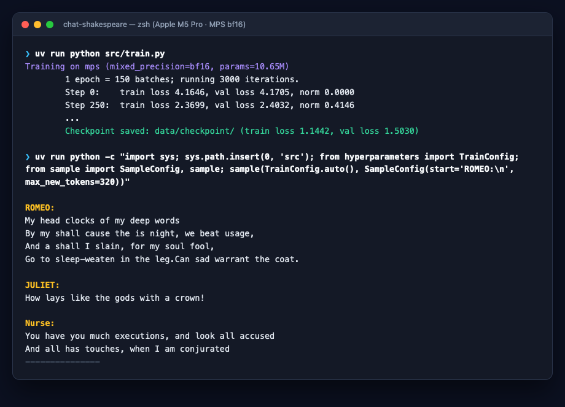

<h1 align="center">
  &nbsp; Chat Shakespeare
</h1>

<p align="center">
  A minimal GPT built from scratch in PyTorch. Train a small language model on Shakespeare and generate new plays in a <a href="https://marimo.io">marimo</a> notebook or from the terminal.
</p>

<p align="center">
  =3.14" />
  =2.15" />
  =1.16" />
  =0.8" />
  =0.26" />
  <a href="LICENSE"></a>
</p>

- **Interactive or terminal workflow**: Explore step by step in the [`main.py`](main.py) notebook, or run [`src/train.py`](src/train.py) from the CLI.
- **Automatic hardware tuning**: [`TrainConfig.auto()`](src/hyperparameters.py) picks a model size, precision, and batch settings for your CPU, Apple Silicon (`mps`), or NVIDIA GPU (`cuda`).
- **From scratch or GPT-2**: Train a modern mini-GPT from scratch on Tiny Shakespeare, or fine-tune pretrained GPT-2 weights stored safely as `safetensors`.

> **New to LLMs?** Start with the **[Beginner's Guide](docs/concepts.md)** for a plain-English walkthrough of tokenization, Transformers, training, and sampling.

## Quickstart

Requires Python `>=3.14` and [`uv`](https://docs.astral.sh/uv/) (handles virtual environments and dependencies automatically).

### 1. Install

```bash
git clone https://github.com/NewGuy012/chat-shakespeare.git
cd chat-shakespeare
uv sync
```

### 2. Run the Interactive Notebook (Recommended)

```bash
uv run marimo edit main.py
```

This opens a 5-cell notebook that downloads Tiny Shakespeare, tokenizes it, trains your model, and generates sample text. You can edit the prompt or `temperature` in the last cell anytime without retraining—cached tokens and checkpoints are reused automatically.

### 3. Or Train & Generate from the Terminal

```bash
# Train with automatic settings for your machine (CPU, Apple Silicon, or CUDA GPU)
uv run python src/train.py

# Generate Shakespeare from the saved checkpoint
uv run python -c "import sys; sys.path.insert(0, 'src'); from hyperparameters import TrainConfig; from sample import SampleConfig, sample; sample(TrainConfig.auto(), SampleConfig(start='ROMEO:\n'))"
```

Want to fine-tune pretrained GPT-2 instead of training from scratch?

```bash
uv run python src/train.py --init-from gpt2 --lr 3e-4
```

<details>
<summary>Advanced CLI options, tests, and cloud GPU tips</summary>

```bash
# Classic GPT-2 architecture or early stopping on validation loss plateau
uv run python src/train.py --arch gpt2 --early-stopping 3

# Multi-GPU or explicit CPU launch with Hugging Face Accelerate
uv run accelerate launch --multi_gpu --mixed_precision bf16 src/train.py
uv run accelerate launch --cpu src/train.py

# See all CLI flags
uv run python src/train.py --help

# Run the test suite
uv run python -m unittest discover -s tests
```

- **Cloud GPU / CUDA tips:** Persist `TORCHINDUCTOR_CACHE_DIR`, `TRITON_CACHE_DIR`, and `TORCHINDUCTOR_FX_GRAPH_CACHE=1` across restarts to skip `torch.compile` warmup. [`uv.lock`](uv.lock) resolves PyTorch `2.15` CUDA 13 (`cu13`) wheels on Linux; on older CUDA 12 drivers, point `[tool.uv.sources]` in [`pyproject.toml`](pyproject.toml) at a matching PyTorch CUDA index.

</details>

## Screenshots

### Interactive marimo notebook (`main.py`)


### CLI training & sampling on Apple Silicon (`mps`, `bf16`)


## Hardware Presets & Project Layout

`TrainConfig.auto()` automatically scales the model for your device (plus batch size and learning rate tiers on CUDA):

| Hardware | Model Size | Context Window | Precision |
| :--- | :--- | ---: | :--- |
| CPU | ~0.92M params (`4` layers) | 128 tokens | `fp32` |
| Apple Silicon (`mps`) | ~11.02M params (`6` layers) | 256 tokens | `bf16` |
| NVIDIA GPU (`cuda`) | ~11.02M params (`6` layers) | 256 tokens | `bf16` / `fp16` (+ `torch.compile`) |

- [`main.py`](main.py) — Interactive 5-cell marimo notebook
- [`src/`](src) — Core modules (`tokenizer.py`, `model.py`, `train.py`, `sample.py`, `hyperparameters.py`)
- [`docs/concepts.md`](docs/concepts.md) — Beginner's guide, detailed [hardware presets](docs/concepts.md#44-hardware-tricks-presets-mixed-precision-accumulation-and-accelerate), and [code reading map](docs/concepts.md#code-reading-map)
- `data/` — Cached dataset, tokens, and checkpoints (created on first run)

---

BSD 2-Clause [LICENSE](LICENSE) · Moses Yoo · Inspired by Andrej Karpathy's [nanoGPT](https://github.com/karpathy/nanoGPT) and Zero to Hero series.
