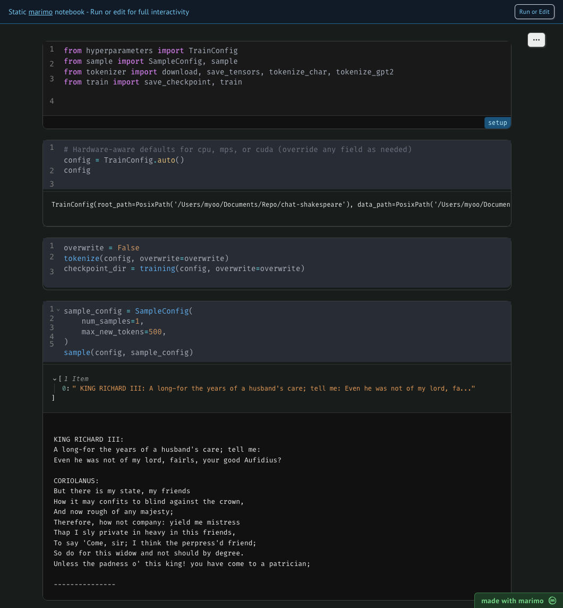

<h1 align="center">
  &nbsp; Chat Shakespeare
</h1>

<p align="center">
  A small GPT language model built from scratch in PyTorch. Train it on Shakespeare and generate new plays in a <a href="https://marimo.io">marimo</a> notebook or from your terminal.
</p>

<p align="center">
  =3.14" />
  =2.15" />
  =1.16" />
  =0.8" />
  =0.26" />
  <a href="LICENSE"></a>
</p>

- **Notebook or terminal**: Run [`main.py`](main.py) as an interactive notebook to explore each step, or run [`src/train.py`](src/train.py) in your terminal.
- **Works on your hardware**: Automatically picks a good model size and speed settings for your CPU, Mac (Apple Silicon), or NVIDIA GPU.
- **From scratch or GPT-2**: Train a mini-GPT from scratch on Tiny Shakespeare, or start from pretrained GPT-2 weights.

> **New to LLMs?** Read **[`docs/concepts.md`](docs/concepts.md)** for a plain-English guide to how GPT works (tokens, attention, training, and text generation), 6 hands-on experiments, and how modern frontier LLMs build on these basics.

## Quickstart

Requires Python `>=3.14` and [`uv`](https://docs.astral.sh/uv/) (which sets up the environment and packages for you).

### 1. Install

```bash
git clone https://github.com/NewGuy012/chat-shakespeare.git
cd chat-shakespeare
uv sync
```

### 2. Run the Interactive Notebook (Recommended)

```bash
uv run marimo edit main.py
```

This opens a 5-step notebook that downloads Shakespeare, prepares the text, trains your model, and writes sample dialogue. You can change the starting prompt or creativity (`temperature`) in the last cell anytime without retraining—saved progress is reused automatically.

### 3. Or Train & Generate in the Terminal

```bash
# Train with automatic settings for your machine
uv run python src/train.py

# Generate Shakespeare from the trained model
uv run python -c "import sys; sys.path.insert(0, 'src'); from hyperparameters import TrainConfig; from sample import SampleConfig, sample; sample(TrainConfig.auto(), SampleConfig(start='ROMEO:\n'))"
```

Want to fine-tune pretrained GPT-2 instead of training from scratch?

```bash
uv run python src/train.py --init-from gpt2 --lr 3e-4
```

<details>
<summary>More options: multiple GPUs, tests, and cloud GPU tips</summary>

```bash
# Use the classic GPT-2 design, or stop early if training stops improving
uv run python src/train.py --arch gpt2 --early-stopping 3

# Run on multiple GPUs, or force CPU mode
uv run accelerate launch --multi_gpu --mixed_precision bf16 src/train.py
uv run accelerate launch --cpu src/train.py

# See all command-line options
uv run python src/train.py --help

# Run tests
uv run python -m unittest discover -s tests
```

- **Cloud GPU tips:** The first GPU run takes a little longer while PyTorch optimizes code for your graphics card—pass `--no-compile` to skip this for quick tests, or keep your cache folder on persistent storage so restarts stay fast. Linux installs PyTorch for CUDA 13 by default; if a cloud GPU uses CUDA 12, configure a CUDA 12 PyTorch source in [`pyproject.toml`](pyproject.toml).

</details>

## Screenshots

### Interactive marimo notebook (`main.py`)


### Terminal training & text generation on Mac (Apple Silicon)


## Default Settings by Hardware & Project Files

The code automatically scales the model to fit your device (and adjusts batch size for NVIDIA GPU memory):

| Hardware | Model Size | Context Length | Precision |
| :--- | :--- | ---: | :--- |
| CPU | ~0.92M params (`4` layers) | 128 tokens | Standard (`fp32`) |
| Apple Silicon Mac | ~11.02M params (`6` layers) | 256 tokens | Fast 16-bit (`bf16`) |
| NVIDIA GPU | ~11.02M params (`6` layers) | 256 tokens | Fast 16-bit (`bf16` / `fp16`) |

- [`main.py`](main.py) — Interactive 5-step marimo notebook (best place to start)
- [`src/`](src) — Core Python code for tokenizing, model building, training, and generating text
- [`docs/concepts.md`](docs/concepts.md) — Beginner's guide, 6 hands-on experiments, full [hardware preset details](docs/concepts.md#44-hardware-tricks-presets-mixed-precision-accumulation-and-accelerate), and [code reading map](docs/concepts.md#code-reading-map)
- `data/` — Downloaded text, tokens, and saved models (created automatically on first run)

---

BSD 2-Clause [LICENSE](LICENSE) · Moses Yoo · Inspired by Andrej Karpathy's [nanoGPT](https://github.com/karpathy/nanoGPT) and Zero to Hero series.
