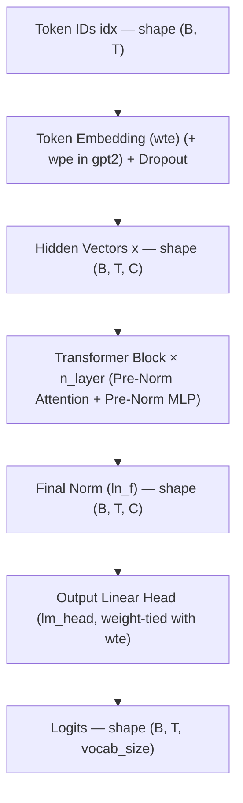
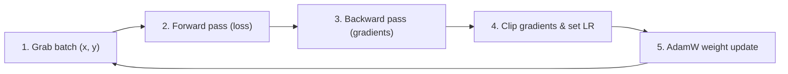

# How Chat Shakespeare Works: A Beginner's Guide to Building an LLM

Chat Shakespeare is a minimal, from-scratch **GPT (Generative Pre-trained Transformer)** written in ~2,000 lines of readable Python across five modules in [`src/`](../src). It uses the exact same core architecture as GPT-2 and modern Large Language Models (LLMs) — just scaled down so you can train one on your own laptop, inspect every line of code, and learn by experimenting.

You don't need a PhD or a heavy math background to follow along. If you know basic Python and have heard of arrays (tensors), you're ready.

---

## Table of Contents

- [The Big Picture: What Is an LLM Actually Doing?](#the-big-picture-what-is-an-llm-actually-doing)
- [Step 1: Tokenization (Turning Text into Numbers)](#step-1-tokenization-turning-text-into-numbers)
- [Step 2: Training Data (Context Windows and Shifted Targets)](#step-2-training-data-context-windows-and-shifted-targets)
- [Step 3: Inside the GPT Architecture](#step-3-inside-the-gpt-architecture)
  - [3.1 Embeddings: Meaning and Position](#31-embeddings-meaning-and-position)
  - [3.2 The Transformer Block: Communicate, Then Think](#32-the-transformer-block-communicate-then-think)
  - [3.3 Causal Self-Attention: Looking Backward for Context](#33-causal-self-attention-looking-backward-for-context)
  - [3.4 The MLP: Thinking About What Was Gathered](#34-the-mlp-thinking-about-what-was-gathered)
  - [3.5 Residual Connections and Normalization](#35-residual-connections-and-normalization)
  - [3.6 Predicting the Next Token and Weight Tying](#36-predicting-the-next-token-and-weight-tying)
  - [3.7 Bonus: Loading Real Pretrained GPT-2 Weights](#37-bonus-loading-real-pretrained-gpt-2-weights)
- [Step 4: Training (How the Model Actually Learns)](#step-4-training-how-the-model-actually-learns)
  - [4.1 Cross-Entropy Loss: Measuring Surprise](#41-cross-entropy-loss-measuring-surprise)
  - [4.2 Backpropagation, AdamW, and Gradient Clipping](#42-backpropagation-adamw-and-gradient-clipping)
  - [4.3 Learning Rate Schedule: Warmup and Cosine Decay](#43-learning-rate-schedule-warmup-and-cosine-decay)
  - [4.4 Hardware Tricks: Presets, Mixed Precision, Accumulation, and Accelerate](#44-hardware-tricks-presets-mixed-precision-accumulation-and-accelerate)
  - [4.5 Smart Caching and Portable Checkpoints](#45-smart-caching-and-portable-checkpoints)
- [Step 5: Sampling (Generating New Shakespeare)](#step-5-sampling-generating-new-shakespeare)
- [Learn by Doing: 6 Hands-On Experiments](#learn-by-doing-6-hands-on-experiments)
- [Code Reading Map](#code-reading-map)
- [Hyperparameter Cheat Sheet](#hyperparameter-cheat-sheet)

---

## The Big Picture: What Is an LLM Actually Doing?

Under the hood, every GPT-style LLM has one surprisingly simple job:

> **Given some text so far, predict the probability of every possible next piece of text (token).**

That's it! When you feed `"ROMEO:\nO, she doth teach the torches to burn "`, the model outputs a score for every token it knows. A well-trained model puts a high probability on `"bright"` (or `"b"` if you choose the character-level tokenizer), and tiny probabilities on `"?"` or `"z"`.

What makes this magical is what emerges as a side effect. To get really good at guessing the next token of Shakespeare, the model *has* to learn:
- Spelling and English words
- Punctuation and capitalization
- Play formatting (`CHARACTER NAME:\nDialogue...`)
- Poetic rhythm and dramatic tone

### The 4-Stage Pipeline in This Repo


[`main.py`](../main.py) wires all four stages together inside an interactive [marimo](https://marimo.io) notebook across five small cells:
1. **Configure** — [`TrainConfig.auto()`](../src/hyperparameters.py#L502-L567) picks hardware-aware defaults for your CPU, Apple Silicon, or CUDA GPU.
2. **Tokenize** — [`prepare_tokens()`](../src/tokenizer.py#L198-L213) downloads and tokenizes Tiny Shakespeare once (reusing the cache on future runs).
3. **Train** — [`ensure_checkpoint()`](../src/train.py#L482-L497) trains the model and saves a fingerprinted checkpoint (or skips straight to the cache if that config was already trained).
4. **Load** — [`load_checkpoint()`](../src/train.py#L203-L233) loads the weights into memory in its own cell.
5. **Sample** — [`sample()`](../src/sample.py#L37-L98) generates new Shakespeare — and because loading is a separate cell, you can tweak `temperature`, `top_k`, or your prompt and re-generate instantly without reloading weights or retraining!

---

## Step 1: Tokenization (Turning Text into Numbers)

> **Code:** [`src/tokenizer.py`](../src/tokenizer.py)

Neural networks can only do math on numbers, not text. A **tokenizer** is the translator between human text and integer IDs:

- **`encode(text)`**: converts text into a list of integer token IDs (e.g., subword chunks in BPE, or individual letters in character mode).
- **`decode(ids)`**: converts those token IDs right back into readable text.

The set of all unique symbols a tokenizer knows is its **vocabulary**, and its size is called `vocab_size`.

Chat Shakespeare includes **three tokenizers** so you can compare custom subword, character-level, and pretrained tokenization:

| Feature | Custom Byte-Level BPE (`tokenize_bpe`, default) | Character-level (`tokenize_char`) | GPT-2 BPE (`tokenize_gpt2`, via `tiktoken`) |
| :--- | :--- | :--- | :--- |
| **Unit** | Learned Shakespeare subwords (`'ROMEO'`, `' the'`, `'ing'`) + `<\|endoftext\|>` | Single characters (`'R'`, `'O'`, `'M'`, `'E'`, `'O'`) | General English subword chunks (`'Sh'`, `'akespeare'`) + `<\|endoftext\|>` |
| **Tokenizer `vocab_size`** | **1,024** default (`--vocab-size`, min **257**) | **65** (every unique character in Tiny Shakespeare) | **50,257** |
| **Model embedding size** | **1,024** (padded up to a multiple of 64 if custom) | **128** (`65` padded up to `2 × 64`) | **50,304** (`50,257` padded up to `786 × 64`) |
| **Sequence length** | Medium (~2.4× compression; `"Shakespeare"` = 7 tokens) | Longest (`"Shakespeare"` = 11 tokens) | Shortest (`"Shakespeare"` = 2 tokens) |
| **Unknown characters** | Handled cleanly via byte-level fallback | Raises `ValueError` on unseen characters | Handled cleanly via byte-level fallback |
| **Best for** | Training from scratch (default) | Studying character-by-character learning | Fine-tuning pretrained GPT-2 weights |

### Why default to a 1,024-token Byte-Level BPE when training from scratch?
A small Byte-Pair Encoding (BPE) vocabulary trained directly on Tiny Shakespeare via Hugging Face `tokenizers` gives you the best of both worlds:
- **~2.4× longer effective context** inside the same `block_size` window compared to character-level tokens — the model sees more than twice as much play dialogue at once.
- **No wasted parameters or OOV errors:** Unlike GPT-2's 50,257-token table (where most tokens never appear in Shakespeare), every token in a 1,024-token vocabulary is learned directly from the corpus, and byte-level fallback (starting from the 256 raw byte values plus `<|endoftext|>`, hence the minimum `bpe_vocab_size = 257`) handles any UTF-8 prompt character cleanly.

> **Why pad model vocab sizes up to multiples of 64?**  
> GPUs and modern CPU vector instructions run matrix multiplications fastest when dimensions are clean multiples of 64. [`pad_vocab_size()`](../src/hyperparameters.py#L64-L68) automatically rounds the model's embedding table up (`65 → 128`, `50,257 → 50,304`, while `1,024 = 16 × 64` is already aligned!). During text generation, any padded slots are masked out so the model can never sample a fake token ID.

### Train Split vs. Validation Split
[`src/tokenizer.py`](../src/tokenizer.py) caches each tokenizer in its own folder under `data/tokens/<tokenizer>/` (e.g., `bpe-1024`, `bpe-512`, `char`, `gpt2` — so switching tokenizers never overwrites earlier work) and saves two split files:
- `data/tokens/bpe-1024/train.safetensors` — the text the model studies from.
- `data/tokens/bpe-1024/val.safetensors` — text kept **hidden** from training so we can test whether the model is genuinely learning Shakespearean style or just memorizing the training text.

### Why `safetensors`, atomic JSON writes, and pinned Hub revisions?
Older tutorials often save data with Python's `pickle`. Pickle files can execute arbitrary code when loaded (a security hazard) and aren't human-readable. Instead, this repo builds caching with safety and reproducibility in mind:
- **`.safetensors`** for raw numeric tensors — fast, zero arbitrary code execution, and validated via header checks in [`tokens_ready()`](../src/tokenizer.py#L173-L195).
- **Atomic writes (`meta.json` last)**: [`tokenize_bpe()`](../src/tokenizer.py#L93-L133), [`tokenize_char()`](../src/tokenizer.py#L77-L90), and [`tokenize_gpt2()`](../src/tokenizer.py#L136-L154) are pure functions; [`save_tokens()`](../src/tokenizer.py#L157-L170) writes each file to a temporary sibling first ([`atomic_path()`](../src/hyperparameters.py#L90-L104)) and writes `meta.json` **last** so a Ctrl+C mid-save can never leave a half-written cache that looks complete. When loading BPE, [`load_tokenizer()`](../src/tokenizer.py#L216-L263) always reads the fixed `tokenizer.json` inside `token_dir` so untrusted metadata can't point outside the cache directory.
- **Pinned Hugging Face Hub revisions** in [`src/tokenizer.py`](../src/tokenizer.py#L28-L29) (`Trelis/tiny-shakespeare`) and [`src/hyperparameters.py`](../src/hyperparameters.py#L37-L42) (pretrained GPT-2 weights) so downloads are 100% reproducible.

---

## Step 2: Training Data (Context Windows and Shifted Targets)

> **Code:** [`TokenBatcher`](../src/train.py#L88-L161) and [`_build_batcher`](../src/train.py#L164-L184) in `src/train.py`

Where do the "right answers" come from if nobody manually labeled Shakespeare?

**The text itself is the answer key!** This is called **self-supervised learning**.

We slice the long 1D stream of token IDs into chunks of length `block_size` (also called the **context window** — e.g., 128 tokens on CPU or 256 on Apple Silicon / CUDA). For every input chunk `x`, the target `y` is the exact same chunk **shifted right by 1 position** *(shown with single characters below for readability; with the default BPE tokenizer, each slot holds a subword token instead)*:

```text
Text stream:  F  i  r  s  t     C  i  t  i  z  e  n

Input  x:   [ F, i, r, s, t,  , C, i ]   (positions 0..7)
Target y:   [ i, r, s, t,  , C, i, t ]   (positions 1..8)
```

### The Parallel Training Trick
Notice how clever this is! One chunk of length `T = 8` doesn't just give the model 1 prediction task — it gives **8 tasks at the exact same time**:

- Given `F` → predict `i`
- Given `Fi` → predict `r`
- Given `Fir` → predict `s`
- ...
- Given `First Ci` → predict `t`

We then group `batch_size` (written `B`) independent chunks together into a 2D tensor of shape **`(B, T)`** so the CPU or GPU crunches many windows in parallel.

### Fast, Deterministic Batching with `TokenBatcher`
Because Tiny Shakespeare's tokenized splits are only a few megabytes, [`TokenBatcher`](../src/train.py#L88-L161) automatically optimizes memory placement:
- **Small splits (`<= 256 MB`)**: kept directly on your CPU, MPS, or CUDA device so random `(B, T)` batches are gathered on the fly with vectorized indexing (`starts[:, None] + offsets[None, :]`) and zero per-step host-to-device copies.
- **Large splits (`> 256 MB`)**: kept in CPU RAM, transferring only each sampled `(B, T)` batch (using `non_blocking=True` on CUDA).
- **Reproducible batches**: each split and distributed worker gets its own seeded `torch.Generator`, and [`iter_eval()`](../src/train.py#L152-L161) resets a fresh seeded generator every evaluation so validation loss comparisons stay apples-to-apples across training steps.

---

## Step 3: Inside the GPT Architecture

> **Code:** [`src/model.py`](../src/model.py)

From-scratch training defaults to **`arch="modern"`**, which keeps the classic Transformer block layout while swapping in modern LLM upgrades that train faster and stay stable at higher learning rates. Whenever you load pretrained OpenAI GPT-2 weights (`--init-from gpt2`) or a saved GPT-2 checkpoint, Chat Shakespeare automatically switches to **`arch="gpt2"`**:

| Component | `modern` (default from scratch) | `gpt2` (auto-enabled for GPT-2 weights) |
| :--- | :--- | :--- |
| **Position encoding** | **RoPE** (Rotary Position Embeddings on Q/K) | Learned position table (`wpe`) |
| **Normalization** | **`RMSNorm`** (pre-norm + QK-Norm) | `LayerNorm` |
| **MLP activation** | **`ReLU²`** (`F.relu(h).square()`) | `GELU` (`F.gelu(h, approximate="tanh")`) |
| **Linear biases** | `bias=False` by default for scratch training | `bias=True` when loading pretrained GPT-2 |

Let's follow a batch of token IDs of shape `(B, T)` as it travels from the front of [`GPT.forward`](../src/model.py#L304-L344) to the final next-token predictions:



*(Here `B` = `batch_size`, `T` = sequence length `<= block_size`, and `C` = `n_embd`, the vector size representing each token.)*

### 3.1 Embeddings: Meaning and Position

> **Code:** [`Transformer`](../src/model.py#L245-L272), [`_build_rope_cache`](../src/model.py#L79-L91), and [`_apply_rope`](../src/model.py#L94-L98)

Token ID `42` isn't "greater than" token ID `10` — they are just arbitrary labels. So the very first step converts each integer ID into a **vector** of `n_embd` (e.g., `128` on CPU, `384` on MPS/CUDA, `768` on GPT-2 Small) learnable floating-point numbers:

1. **Token Embedding (`wte`)**: A lookup table of shape `(vocab_size, n_embd)`. Think of each row as a learned list of features describing what that token tends to mean and how it behaves.
2. **Position Information (`RoPE` vs. `wpe`)**: Attention alone treats inputs like a shuffled bag of tokens (`"dog bites man"` looks identical to `"man bites dog"`).
   - In **`arch="modern"`** (default): instead of adding a learned table at the input, **Rotary Position Embeddings (RoPE)** rotate pairs of coordinates in each Query and Key vector inside attention like clock hands turning with position. When a Query and Key take a dot product, the angle *between* them naturally encodes **relative distance**! *(Because RoPE rotates dimensions in pairs, `arch="modern"` requires `head_dim = n_embd // n_head` to be even.)*
   - In **`arch="gpt2"`**: a learned position table (`wpe`) of shape `(block_size, n_embd)` is looked up and added to `wte(idx)`.

*(Both the precomputed RoPE cosine/sine tables and GPT-2's `pos` index tensor are registered as non-persistent buffers so they move to your GPU automatically without bloating saved checkpoints.)*

Now every token at every position has its own rich vector of size `C = n_embd`, giving tensor shape **`(B, T, C)`**.

*(The `drop` step is **Dropout**: during training, it randomly zeroes out a fraction of numbers — e.g., `0.1` on CPU or `0.2` on MPS/CUDA — forcing the model not to over-rely on any single memorized path.)*

### 3.2 The Transformer Block: Communicate, Then Think

> **Code:** [`Block`](../src/model.py#L224-L242)

The core of GPT is simply a stack of `n_layer` identical **Transformer Blocks** (4 layers on CPU, 6 on MPS/CUDA, 12 on GPT-2 Small, up to 48 on GPT-2 XL). Each block updates every token's vector in two stages:

```python
x = x + self.attn(
    self.ln_1(x), rope=rope, pos_offset=pos_offset, kv_cache=kv_cache
)  # 1. Communicate with earlier tokens
return x + self.mlp(self.ln_2(x))  # 2. Think individually about what was gathered
```

Think of a group of readers sitting in a row, each holding one token of a sentence:
1. **Attention (`attn`)** is the **communication step**: each reader asks earlier readers for context (*"Are we inside a character name? Did someone just open a quote? What phrase started a few tokens ago?"*).
2. **MLP (`mlp`)** is the **thinking step**: each reader privately digests the notes they just collected before passing their updated vector to the next layer.

Repeating this 4 to 6 times lets the network build progressively higher-level understanding — from neighboring tokens in early layers, to whole words and syntax, to speaker turns and dramatic dialogue in deeper layers.

### 3.3 Causal Self-Attention: Looking Backward for Context

> **Code:** [`CausalSelfAttention`](../src/model.py#L145-L207)

Self-attention is the breakthrough idea from *"Attention Is All You Need"*. Here's the intuition:

For every token vector, the layer creates three projections using a single linear layer (`c_attn`):
- **Query (`q`)** — *"What kind of information am I looking for right now?"*
- **Key (`k`)** — *"What kind of information do I contain?"*
- **Value (`v`)** — *"If you decide to pay attention to me, here is the information I will give you."*

Next, each token compares its **Query** against every other token's **Key** via a dot product:

$$\text{Attention}(Q, K, V) = \text{softmax}\!\left(\frac{Q K^\top}{\sqrt{d_{\text{head}}}} + \text{causal mask}\right) V$$

Let's unpack every single piece of that formula:
1. **Dot product ($Q K^\top$)**: Measures compatibility. High score = *"this earlier token has what I'm looking for!"*
2. **Scaling ($\div \sqrt{d_{\text{head}}}$)**: Keeps dot products from growing too large as vectors get wider; otherwise softmax turns overly sharp and training stalls.
3. **Causal Mask**: Blocks every token from looking into the **future**. Token #3 can only attend to tokens #0, #1, #2, #3 — never #4 or #5. Without this mask, the model would cheat during training by peeking ahead at the answer!
   ```text
   Token attending ↓  | Can look at →  0   1   2   3
   -------------------+-----------------------------
   Position 0 ('F')   |                ✓   ✗   ✗   ✗
   Position 1 ('i')   |                ✓   ✓   ✗   ✗
   Position 2 ('r')   |                ✓   ✓   ✓   ✗
   Position 3 ('s')   |                ✓   ✓   ✓   ✓
   ```
4. **Softmax**: Turns allowed scores into positive weights that sum to `1.0` (like percentages of attention).
5. **Weighted sum of Values ($\times V$)**: Blends the Value vectors of earlier tokens according to those attention weights.

#### Multi-Head Attention (`n_head`)
Instead of doing one big attention lookup over all `n_embd` numbers, we split each vector into `n_head` parallel **heads**, each of width `head_dim = n_embd // n_head` (which is why `n_embd` must be divisible by `n_head`!).

- On `mps` / `cuda`: `n_embd = 384`, `n_head = 6` → **6 heads**, each of dimension **64**.
- Different heads naturally specialize: one might track the previous couple of tokens for spelling or phrasing, another might track newlines and colons for speaker turns, another might look further back for rhythm or punctuation.
- Afterward, the heads are stitched back together into `(B, T, C)` and mixed via `c_proj`.

> **Modern Upgrades Inside Attention:**
> - **Fused Attention (`F.scaled_dot_product_attention`)**: [`src/model.py`](../src/model.py#L198-L205) lets PyTorch handle scaling, masking, softmax, and dropout in one call — automatically dispatching to ultra-fast fused kernels (like FlashAttention on CUDA). During training it sets `is_causal=True`; during KV-cached decoding it automatically adapts the causal mask for single-token or multi-token appends.
> - **QK-Norm (`arch="modern"`)**: Right before RoPE rotation, queries and keys each pass through per-head [`RMSNorm`](../src/model.py#L64-L76). Without it, attention dot products can occasionally spike at higher learning rates and cause softmax to collapse onto a single token.

### 3.4 The MLP: Thinking About What Was Gathered

> **Code:** [`MLP`](../src/model.py#L210-L221)

After attention gathers context across positions, each token independently passes through a two-layer **Multi-Layer Perceptron (MLP)** (also called a Feed-Forward Network):

1. **Expand 4×** (`c_fc`): `n_embd` → `4 * n_embd` (gives the network extra scratchpad space to compute complex feature combinations).
2. **Activation (`ReLU²` or `GELU`)**: Applies a nonlinear curve — **`ReLU²`** (`F.relu(h).square()`) in `modern`, or **`GELU`** (`F.gelu(h, approximate="tanh")`) in `gpt2`. Without a nonlinearity, stacking linear layers would mathematically collapse into a single matrix multiplication and couldn't learn complex patterns! `ReLU²` is fast, cleanly zeroes out negative activations for sparsity, and trains noticeably well on compact Transformers.
3. **Compress back** (`c_proj`): `4 * n_embd` → `n_embd`, followed by dropout.

### 3.5 Residual Connections and Normalization

Look again at those two lines in [`Block.forward`](../src/model.py#L232-L242):

```python
x = x + self.attn(
    self.ln_1(x), rope=rope, pos_offset=pos_offset, kv_cache=kv_cache
)
return x + self.mlp(self.ln_2(x))
```

Two quiet engineering ideas here are what make deep Transformers actually trainable:

- **Residual Connections (`x + ...`)**: Instead of overwriting `x`, each layer adds a *refinement* onto `x`. Think of `x` as a clean "information highway" running straight from the input to the output. During backpropagation, gradients can flow directly down that highway without fading away (*vanishing gradients*).
  *(This is also why [`GPT.__init__`](../src/model.py#L285-L288) scales down the initial weights of every `c_proj` layer by $1 / \sqrt{2 \cdot n_{\text{layer}}}$: it keeps the residual stream from growing wildly as more blocks add onto it.)*
- **Pre-Norm (`ln_1`, `ln_2`, `ln_f`)**: Before entering attention or the MLP, each token vector's magnitude is rescaled so numbers neither explode nor shrink to zero across layers:
  - **`RMSNorm`** (default in `modern`, [`src/model.py`](../src/model.py#L64-L76)): divides by the vector's root-mean-square magnitude and applies a learned scale (skipping mean-centering for speed and simplicity, while cleanly matching the activation dtype under mixed-precision autocast).
  - **`LayerNorm`** (used in `gpt2`): subtracts the mean and divides by the standard deviation before scaling.

### 3.6 Predicting the Next Token and Weight Tying

> **Code:** [`GPT.__init__`](../src/model.py#L275-L289) and [`GPT.forward`](../src/model.py#L304-L344)

After the final Transformer block and final normalization (`ln_f`), the **language modeling head (`lm_head`)** projects each token's `n_embd` vector into `vocab_size` raw scores called **logits** — one score for every token in the vocabulary.

Two neat details in [`src/model.py`](../src/model.py):
- **Weight Tying** (`self.transformer.wte.weight = self.lm_head.weight`): The input token embedding table and the final output projection share the **exact same matrix**! Intuitively, if two tokens behave similarly going *in*, they should also occupy similar directions coming *out*. This cuts down parameter count and improves generalization.
- **Training & inference fast paths**: During training (`targets is not None` with `return_logits=False`), `GPT.forward` computes cross-entropy loss and returns `(None, loss)` so mixed-precision wrappers never keep a giant logits tensor alive. During text generation (`targets is None`), we only run `lm_head` on the very last position `x[:, [-1], :]` and reuse cached keys/values via [`KVCache`](../src/model.py#L107-L142).

### 3.7 Bonus: Loading Real Pretrained GPT-2 Weights

> **Code:** [`GPT.from_pretrained`](../src/model.py#L374-L446), [`crop_block_size`](../src/model.py#L346-L371), and [`infer_arch_from_weights`](../src/hyperparameters.py#L123-L131)

Even though [`src/model.py`](../src/model.py) is compact, switching `arch="gpt2"` makes it **architecturally identical to OpenAI's GPT-2** across all four sizes (`gpt2` 124M, `gpt2-medium` 355M, `gpt2-large` 774M, `gpt2-xl` 1.5B):
- `GPT.from_pretrained("gpt2")` downloads the official `model.safetensors` weights straight from a pinned Hugging Face Hub revision — without even needing the `transformers` library or `pickle`.
- It transposes OpenAI's 4 `Conv1D` matrices to match PyTorch's `nn.Linear`, pads the 50,257-row vocabulary cleanly to `50,304` (zeroing the 47 padding rows), and verifies that every expected weight key matches strictly.
- **Automatic detection**: passing `--init-from gpt2` automatically sets `arch="gpt2"` and `tokenizer="gpt2"`. You can also pass any saved local checkpoint folder (`--init-from data/checkpoints/<run>`) to continue fine-tuning; both [`TrainConfig.auto`](../src/hyperparameters.py#L502-L567) and [`load_checkpoint`](../src/train.py#L203-L233) inspect `model.safetensors` keys (`wpe.weight`) via [`infer_arch_from_weights()`](../src/hyperparameters.py#L123-L131) so saved checkpoints always load with the right architecture.
- **Shorter context fine-tuning**: if you fine-tune 1,024-context GPT-2 (or any checkpoint) with a smaller `block_size` (e.g., `block_size=256`), [`crop_block_size()`](../src/model.py#L346-L371) cleanly trims `wpe` / `pos` (or the RoPE tables in `modern`) to fit.

---

## Step 4: Training (How the Model Actually Learns)

> **Code:** [`src/train.py`](../src/train.py) and [`src/hyperparameters.py`](../src/hyperparameters.py)

At step 0, all weights are random noise, so the model outputs pure gibberish. Training repeats a simple 5-step loop `max_iters` times:



### 4.1 Cross-Entropy Loss: Measuring Surprise

How do we score the model's guesses? With **Cross-Entropy Loss** (`F.cross_entropy`):
1. Convert the raw logits for a position into probabilities using **softmax**.
2. Look up the probability $p$ the model gave to the **actual** next token.
3. Compute $-\ln(p)$.

- If the model was 100% confident in the right token ($p = 1.0$), loss = $-\ln(1) = 0$.
- If the model gave the right token a tiny probability ($p = 0.01$), loss = $-\ln(0.01) \approx 4.61$ (big penalty!).

#### Sanity-Check Math You Can Verify Live!
At step 0, with random weights and a model output table of size $V$ (after rounding up to a multiple of 64), the untrained model assigns roughly $1/V$ probability to every output slot:

$$\text{Expected initial loss} = -\ln\!\left(\frac{1}{V}\right) = \ln(V)$$

- **Default 1,024-token BPE** ($V = 1024$): $\ln(1024) \approx 6.93$.
- **65-character tokenizer** (`--tokenizer char`, padded to $V = 128$ in the model): $\ln(128) \approx 4.85$ *(even though only 65 characters exist, the random initial weights spread probability across all 128 padded slots; within a few steps the model learns to push the 63 unused slots toward zero!)*.
- **GPT-2 BPE from scratch** (`--tokenizer gpt2`, padded to $V = 50,304$): $\ln(50304) \approx 10.83$.

When you run training, watch **Step 0** in the logs — it will start right around that theoretical baseline! *(Note: raw cross-entropy loss rises with larger vocabularies because each step predicts one of $V$ tokens instead of one character, so only compare losses directly across checkpoints that share the same tokenizer.)*

#### Watching Logs, Overfitting, and Early Stopping
Every `log_iters` steps (and on the final iteration), [`estimate_loss`](../src/train.py#L286-L308) evaluates the average loss on both `train` and `val` splits, and [`train`](../src/train.py#L311-L429) prints `train loss`, `val loss`, gradient `norm`, and throughput (`ms/iter` and `tok/s`):
- **Healthy learning**: both `train loss` and `val loss` drop together.
- **Overfitting**: `train loss` keeps dropping, while `val loss` flattens out or starts **rising** — meaning the model is memorizing the training lines instead of learning general Shakespearean patterns.
- **Early stopping**: pass `--early-stopping N` (or `early_stopping_patience=N`) to snapshot the best validation weights in CPU memory whenever `val loss` improves, stop automatically after `N` consecutive non-improving evaluations, and restore those best weights before saving!

### 4.2 Backpropagation, AdamW, and Gradient Clipping

- **Backpropagation (`accelerator.backward(loss)`)**: Uses calculus (the chain rule) to compute a **gradient** for every single weight — a number saying *"if you nudge this weight slightly up, does the loss go up or down, and by how much?"*
- **Gradient Clipping (`grad_clip = 1.0`)**: Occasionally a weird batch produces a giant gradient spike that can derail training. Whenever gradients synchronize (`accelerator.sync_gradients`), clipping caps the combined gradient length (printed as `norm`) to `1.0` so no single step causes an explosion — and [`train`](../src/train.py#L311-L429) keeps that scalar on-device until `log_iters` so async GPU/MPS queues never stall between log intervals.
- **AdamW Optimizer ([`configure_optimizers`](../src/model.py#L448-L461))**: Rather than taking blind fixed-size steps, AdamW tracks:
  - **Momentum (`beta1 = 0.9`)**: smooths noisy gradients across steps.
  - **Adaptive step size (`beta2 = 0.99`, or `0.95` on `>=40GB` GPUs with larger batch size 128)**: automatically takes smaller steps on sensitive parameters and larger steps on quiet ones.
  - **Weight Decay (`weight_decay = 0.1`)**: gently shrinks 2D weight matrices toward zero every step to discourage memorization (notice how [`configure_optimizers`](../src/model.py#L448-L461) intentionally skips weight decay on 1D biases and norm parameters!).
  - **`fused=True`**: combines all the optimizer math into a single fast kernel.

### 4.3 Learning Rate Schedule: Warmup and Cosine Decay

> **Code:** [`get_lr`](../src/train.py#L187-L200)

The **learning rate (`lr`)** controls how big a step the optimizer takes. Keeping it constant isn't ideal, so this repo uses the industry-standard schedule:

```text
LR
 ▲
 │      /‾‾‾‾‾‾\
 │     /        \          <- Cosine decay: smooth slowdown
 │    /          \            to settle into a good minimum
 │   /            \___
 │  /                 ‾‾‾  <- min_lr
 └──────────────────────────▶ Training Step
    ▲             ▲
 warmup_iters  lr_decay_iters
 (gentle ramp)
```

1. **Linear Warmup (`warmup_iters`)**: Weights start random, so early gradients are noisy. Ramping LR gently from near `0` up to `learning_rate` prevents early instability.
2. **Cosine Decay**: Gradually lowers LR down to `min_lr` (10% of peak LR) along a smooth cosine curve so the model makes broad progress early and fine-grained refinements late. *(Setting `lr_decay_iters=0` disables decay and keeps LR constant after warmup; [`TrainConfig.auto()`](../src/hyperparameters.py#L502-L567) also automatically syncs `lr_decay_iters = max_iters` and `min_lr = 0.1 * learning_rate` whenever you override `max_iters` or `learning_rate`.)*

### 4.4 Hardware Tricks: Presets, Mixed Precision, Accumulation, and Accelerate

> **Code:** [`TrainConfig.auto`](../src/hyperparameters.py#L502-L567), [`_device_preset`](../src/hyperparameters.py#L203-L246), and [`build_accelerator`](../src/train.py#L53-L85)

Modern LLM training uses a few practical tricks so bigger models run fast on modest hardware — all built right into this repo via [Hugging Face Accelerate](https://huggingface.co/docs/accelerate) and automatically configured by `TrainConfig.auto()`:

| Target | Model | Block | Batch × Accum | LR / Beta2 | Iters | Precision | Compile |
| :--- | :--- | ---: | ---: | ---: | ---: | :--- | :--- |
| `cpu` | 4L / 4H / 128d (~0.92M) | 128 | 16 × 2 | `1.5e-3` / `0.99` | 1,000 | `no` (`fp32`) | `False` |
| `mps` | 6L / 6H / 384d (~11.02M) | 256 | 32 × 2 | `1e-3` / `0.99` | 3,000 | `bf16` (macOS 14+) | `False` |
| `cuda` (`<12GB`) | 6L / 6H / 384d (~11.02M) | 256 | 32 × 2 | `1e-3` / `0.99` | 5,000 | `bf16` / `fp16` | `True` (`reduce-overhead`) |
| `cuda` (`12–39GB`) | 6L / 6H / 384d (~11.02M) | 256 | 64 × 1 | `1e-3` / `0.99` | 5,000 | `bf16` / `fp16` | `True` (`reduce-overhead`) |
| `cuda` (`>=40GB`) | 6L / 6H / 384d (~11.02M) | 256 | 128 × 1 | `1.4e-3` / `0.95` | 2,500 | `bf16` | `True` (`reduce-overhead`) |

- **Mixed Precision (`bf16` / `fp16` vs. `fp32`)**: Standard floats (`fp32`) use 32 bits per number. Brain Float 16 (`bf16`, used on Apple Silicon macOS 14+ and modern CUDA GPUs) uses half the memory and multiplies much faster, while `accelerator.autocast()` keeps numerically sensitive ops safe (plus TF32 matmul precision on CUDA). *(Note: Apple MPS does not support `fp16` autocast, so `TrainConfig` validates that MPS only uses `bf16` or `no`.)*
- **Gradient Accumulation (`gradient_accumulation_steps`)**: Larger batches give cleaner gradient estimates, but might not fit in RAM/VRAM. Instead of running one giant batch of 64, we run **2 micro-batches of 32**, add their gradients together inside `with accelerator.accumulate(model):`, and only update the weights once! Same math as batch size 64, half the peak memory.
- **On-device batching (`TokenBatcher`) & `torch.compile` (`reduce-overhead`)**: Keeps small datasets resident on-device for zero-copy static `(B, T)` batches and enables CUDA Graphs (`mode="reduce-overhead"`) on CUDA GPUs to cut down kernel launch overhead.
- **One Codebase, Any Hardware**: `Accelerate` lets the exact same [`train()`](../src/train.py#L311-L429) function run on CPU, Apple Silicon (`mps`), a single CUDA GPU, or multiple GPUs (`accelerate launch --multi_gpu`, with `gradient_as_bucket_view=True` and `bf16` DDP communication hooks on CUDA).

### 4.5 Smart Caching and Portable Checkpoints

> **Code:** [`TrainConfig.fingerprint`](../src/hyperparameters.py#L396-L440), [`save_checkpoint`](../src/train.py#L432-L458), [`checkpoint_ready`](../src/train.py#L461-L479), and [`ensure_checkpoint`](../src/train.py#L482-L497)

Experimenting with LLMs is way more fun when you don't accidentally overwrite yesterday's best run or wait for unchanged steps to redo work. Everything Chat Shakespeare saves lives cleanly under `data/`:

```text
data/
├── download/                              # Pinned Tiny Shakespeare dataset from HF Hub
├── tokens/
│   ├── bpe-1024/                          # train.safetensors, val.safetensors, tokenizer.json, meta.json
│   ├── char/                              # Separate folder per tokenizer (never clobbers bpe!)
│   └── gpt2/
└── checkpoints/
    └── scratch-modern-bpe1024-6l384d-b256-<12-char-sha256>/
        ├── model.safetensors              # Safe, unwrapped model weights
        └── config.json                    # Portable hyperparameters, fingerprint, and final losses
```

- **Fingerprinted runs**: [`TrainConfig.fingerprint()`](../src/hyperparameters.py#L396-L440) hashes every training-relevant hyperparameter (architecture, tokenizer, block size, learning rate, batch size, seed, etc.) into a deterministic SHA-256 digest while ignoring non-training knobs like `log_iters`, `eval_iters`, `compile`, and `data_path`. Change a hyperparameter and you automatically get a fresh folder; re-run the same config and [`ensure_checkpoint()`](../src/train.py#L482-L497) skips straight to the cached checkpoint!
- **Integrity checks & portability**: [`checkpoint_ready()`](../src/train.py#L461-L479) verifies that `model.safetensors` has valid headers and a matching fingerprint before trusting the cache. [`TrainConfig.to_dict()`](../src/hyperparameters.py#L478-L482) omits machine-local `data_path` when writing `config.json`, so you can copy any checkpoint folder to another machine and [`load_checkpoint()`](../src/train.py#L203-L233) still knows where to find `data/`.
- **Force a rebuild**: pass `--overwrite` on the CLI (or flip `overwrite_tokens = True` / `overwrite_training = True` in [`main.py`](../main.py)) whenever you want to re-run from scratch for the exact same config.

---

## Step 5: Sampling (Generating New Shakespeare)

> **Code:** [`src/sample.py`](../src/sample.py) and [`GPT.generate`](../src/model.py#L464-L536)

Once weights are saved in `data/checkpoints/<run>/model.safetensors`, generating text is an **autoregressive loop** — the model writes one token at a time and feeds its own output back in as the next input:

```text
Prompt:  "\nROMEO:"
  Step 1 → model predicts "\n"      → "\nROMEO:\n"
  Step 2 → model predicts "O,"      → "\nROMEO:\nO,"
  Step 3 → model predicts " she"    → "\nROMEO:\nO, she"
  ... repeats max_new_tokens times!
```

### Key Details Inside `GPT.generate` and `sample`
1. **Evaluation Mode, Autocast & Batched Sampling**: [`sample()`](../src/sample.py#L37-L98) switches to `model.eval()` (disabling dropout, then restoring training mode afterward if needed), wraps generation in `torch.no_grad()` plus `bf16`/`fp16` autocast on GPU/MPS, and expands the prompt across `num_samples` rows so multiple scenes generate **in parallel** in a single pass.
2. **KV Cache (Prefill + Fast Decode) & Sliding Window**: Without caching, generating token #200 would re-process all 199 earlier tokens from scratch! [`KVCache`](../src/model.py#L107-L142) pre-allocates per-layer Key and Value buffers:
   - **Prefill**: processes your prompt once (`pos_offset=0`) to populate the cache.
   - **Decode**: each subsequent step only feeds the **single newest token** (`T = 1`) at `pos_offset = cache_len`, appending its K/V to the buffers instead of recomputing history.
   - **Sliding window**: once generated text reaches `block_size`, the cache cleanly keeps the most recent `max(block_size // 2, 1)` tokens and re-prefills at `pos_offset=0`, letting you generate arbitrarily long scenes past `block_size`.
3. **Vocab Padding Mask (`valid_vocab_size`)**: When a model's embedding table is padded up to a clean multiple of 64 for GPU/SIMD speed (e.g., `65 → 128` for char or `50,257 → 50,304` for GPT-2), logits at padded indices are masked to `-inf` so they can never be sampled.
4. **Temperature (`temperature`, default `0.95`)**: Before softmax, we cast the last-token logits to `float32` for numerical precision and divide by `temperature`:
   - **Low (`0.2`–`0.5`)**: exaggerates differences between scores → confident, conservative, sometimes repetitive.
   - **`1.0`**: samples from the exact learned probabilities.
   - **High (`1.3`–`2.0`)**: flattens probabilities → wilder, more surprising, eventually chaotic gibberish.
5. **Top-k Filtering (`top_k`, default `200`)**: Keeps only the `k` highest-scoring valid tokens and sets every other token's logit to `-inf` (probability `0`). This cuts off the "long tail" of bizarre tokens while preserving variety among good candidates.
   *(Tip: try setting `top_k=5` or `top_k=10` to feel its effect directly, or `top_k=None` to sample from the full vocabulary!)*
6. **Multinomial Sampling (`torch.multinomial`)**: Rolls a weighted die according to the final probabilities rather than always picking the single top token, so every run creates a unique scene.

---

## Learn by Doing: 6 Hands-On Experiments

The best way to understand LLMs is to poke them and watch what breaks or improves. Launch the interactive notebook:

```bash
uv run marimo edit main.py
```

*(Changing `TrainConfig` automatically keys a new cache directory under `data/checkpoints/<run>/` so prior experiments stay preserved; only flip `overwrite_tokens = True` or `overwrite_training = True` in [`main.py`](../main.py) if you want to force rebuilding the same config!)*

### Experiment 1: Watch Language Emerge Over Time
Train for just **10**, **200**, and **1,000+** iterations and sample after each run:
```bash
uv run python src/train.py --max-iters 10
```
- **What to watch:** At step 0, loss starts near $\ln(1024) \approx 6.93$ (or $\ln(65) \approx 4.17$ with `--tokenizer char`) and output is gibberish. Within a couple hundred steps, spaces, line breaks, and speaker prefixes (`KING:`, `FIRST CITIZEN:`) appear first. Coherent phrases and dramatic cadence emerge later!

### Experiment 2: Feel Temperature and Top-k (No Retraining Needed!)
In the sampling cell of [`main.py`](../main.py), keep your already-loaded in-memory checkpoint and try:
- `SampleConfig(start="ROMEO:\n", temperature=0.3, top_k=10)` — focused, safe, slightly repetitive.
- `SampleConfig(start="ROMEO:\n", temperature=0.95, top_k=40)` — natural balance.
- `SampleConfig(start="ROMEO:\n", temperature=1.8, top_k=None)` — chaotic nonsense!

### Experiment 3: Trigger Overfitting on Purpose
In `TrainConfig.auto(...)`, set `dropout=0.0` and `weight_decay=0.0`, and train for a few thousand steps.
- **What to watch:** `train loss` plummets far below `1.0`, while `val loss` bottoms out and starts climbing back up. Now turn `dropout=0.2` back on and compare!

### Experiment 4: Give the Model Goldfish Memory
Compare `TrainConfig.auto(block_size=16)` vs. `TrainConfig.auto(block_size=256)`.
- **What to watch:** With `block_size=16`, the model can only look 16 characters backward — enough to spell short words, not enough to track who is speaking or finish a coherent sentence.

### Experiment 5: Open the Artifacts on Disk
After running once, inspect the plain JSON files created in `data/`:
- `data/tokens/bpe-1024/meta.json` and `tokenizer.json` — see the learned BPE vocabulary and merges (or `data/tokens/char/meta.json` when using `--tokenizer char`).
- `data/checkpoints/<run>/config.json` — see portable hyperparameters (no machine-local paths), cache fingerprint, and final train/val losses saved alongside `model.safetensors`.

### Experiment 6: Fine-Tune Real Pretrained GPT-2 on Shakespeare
Instead of starting from random weights, start from OpenAI's 124M-parameter GPT-2 and fine-tune it on Shakespeare using BPE tokens:
```bash
uv run python src/train.py --init-from gpt2 --max-iters 200
```
- **What to watch:** Compare how quickly a pretrained model adapts to Shakespearean English compared to training from scratch!

---

## Code Reading Map

Want to read the entire implementation top to bottom? Here is the gentlest order through `src/`:

| Order | File | Lines | What You'll Learn |
| :---: | :--- | ---: | :--- |
| 1 | [`src/hyperparameters.py`](../src/hyperparameters.py) | 567 | Shared constants, presets, validation, atomic I/O, `arch` inference, and cache fingerprinting |
| 2 | [`src/tokenizer.py`](../src/tokenizer.py) | 263 | Pinned Tiny Shakespeare download, custom BPE / char / GPT-2 encoding, `safetensors` + JSON cache |
| 3 | [`src/model.py`](../src/model.py) | 536 | Both `modern` (`RMSNorm`/RoPE/QK-Norm/`ReLU²`) and `gpt2` architectures, `KVCache`, `generate`, `from_pretrained` |
| 4 | [`src/train.py`](../src/train.py) | 560 | Unified `TokenBatcher`, cosine LR schedule, `Accelerate` loop, early stopping, portable checkpointing |
| 5 | [`src/sample.py`](../src/sample.py) | 98 | Loading a saved checkpoint and batched mixed-precision sampling with vocab masking |
| 6 | [`tests/test_pipeline.py`](../tests/test_pipeline.py) | 580 | Unit and E2E tests covering tokenizers, presets, validation, KV cache, caching, CLI, and MPS |

---

## Hyperparameter Cheat Sheet

Quick reference for the main fields in [`TrainConfig`](../src/hyperparameters.py#L250-L283) and [`SampleConfig`](../src/sample.py#L17-L22):

| Parameter | Plain-English Meaning | Effect of Increasing / Changing It |
| :--- | :--- | :--- |
| `arch` | Block design (`modern` default vs `gpt2`) | `modern` uses RoPE, `RMSNorm`, QK-Norm, `ReLU²`; `gpt2` matches OpenAI GPT-2 |
| `n_layer` | Number of stacked Transformer blocks | Deeper reasoning capacity; slower & uses more memory |
| `n_head` | Number of parallel attention heads per block | More specialized attention patterns (`n_embd % n_head == 0`) |
| `n_embd` | Width of each token's feature vector (`C`) | Richer token representations; parameter count grows ~quadratically |
| `block_size` | Maximum context window length (`T`) | Longer memory; attention cost grows quadratically with `T` |
| `vocab_size` | Number of unique tokens in the dictionary | Determined by tokenizer (1,024 default BPE, 65→128 char, 50,257→50,304 GPT-2) |
| `batch_size` | Number of chunks processed simultaneously (`B`) | Smoother gradients & faster throughput; uses more memory |
| `gradient_accumulation_steps` | Micro-batches summed before one weight update | Simulates a larger effective batch (`batch_size × accum`) without extra VRAM |
| `dropout` | Fraction of activations randomly zeroed in training | Reduces overfitting; too high makes learning slow/noisy |
| `learning_rate` / `min_lr` | Peak & final step sizes for AdamW | Too high → loss explodes (`NaN`); too low → learns painfully slowly |
| `warmup_iters` | Steps to linearly ramp LR from ~0 to peak | Stabilizes early training |
| `max_iters` | Total training micro-steps to run | More training time; watch `val loss` so you don't overfit |
| `early_stopping_patience` | Eval rounds without val improvement before stopping | Saves GPU time and restores best validation weights (`0` disables) |
| `weight_decay` | Shrinkage penalty on 2D weight matrices | Regularizes model against memorization |
| `grad_clip` | Maximum allowed gradient norm | Prevents sudden training spikes |
| `mixed_precision` | Number format (`no`/`fp32`, `bf16`, `fp16`) | `bf16`/`fp16` speeds up GPU/MPS training & halves activation memory |
| `compile` / `compile_mode` | `torch.compile` toggle & Inductor mode | CUDA defaults to `reduce-overhead` (CUDA Graphs) |
| `temperature` | Creativity dial during generation | Lower = safer/repetitive; higher = diverse/chaotic |
| `top_k` | Keep only the top `k` most likely next tokens | Lower = fewer weird typos; `None` = sample from full vocabulary |
