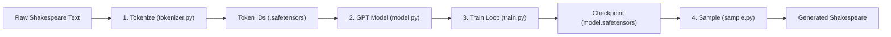
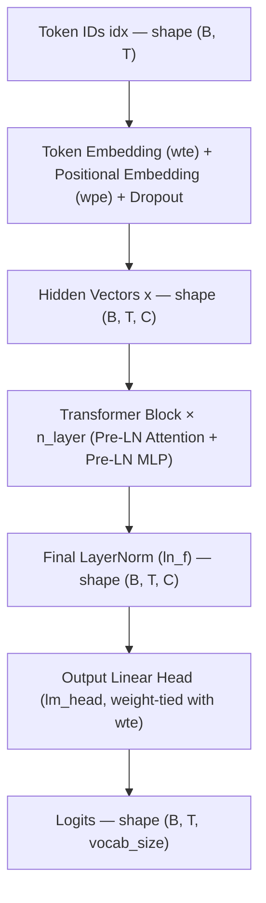
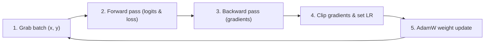

# How Chat Shakespeare Works: A Beginner's Guide to Building an LLM

Chat Shakespeare is a minimal, from-scratch **GPT (Generative Pre-trained Transformer)** written in ~1,000 lines of readable Python across five files. It uses the exact same core architecture as GPT-2 and modern Large Language Models (LLMs)—just scaled down so you can train one on your own laptop, inspect every line of code, and learn by experimenting.

You don't need a PhD or a heavy math background to follow along. If you know basic Python and have heard of arrays (tensors), you're ready.

---

## Table of Contents

- [The Big Picture: What Is an LLM Actually Doing?](#the-big-picture-what-is-an-llm-actually-doing)
- [Step 1: Tokenization (Turning Text into Numbers)](#step-1-tokenization-turning-text-into-numbers)
- [Step 2: Training Data (Context Windows and Shifted Targets)](#step-2-training-data-context-windows-and-shifted-targets)
- [Step 3: Inside the GPT Architecture](#step-3-inside-the-gpt-architecture)
  - [3.1 Embeddings: Meaning and Position](#31-embeddings-meaning-and-position)
  - [3.2 The Transformer Block: Communicate, Then Think](#32-the-transformer-block-communicate-then-think)
  - [3.3 Causal Self-Attention: Looking Backward for Context](#33-causal-self-attention-looking-backward-for-context)
  - [3.4 The MLP: Thinking About What Was Gathered](#34-the-mlp-thinking-about-what-was-gathered)
  - [3.5 Residual Connections and LayerNorm](#35-residual-connections-and-layernorm)
  - [3.6 Predicting the Next Token and Weight Tying](#36-predicting-the-next-token-and-weight-tying)
  - [3.7 Bonus: Loading Real Pretrained GPT-2 Weights](#37-bonus-loading-real-pretrained-gpt-2-weights)
- [Step 4: Training (How the Model Actually Learns)](#step-4-training-how-the-model-actually-learns)
  - [4.1 Cross-Entropy Loss: Measuring Surprise](#41-cross-entropy-loss-measuring-surprise)
  - [4.2 Backpropagation, AdamW, and Gradient Clipping](#42-backpropagation-adamw-and-gradient-clipping)
  - [4.3 Learning Rate Schedule: Warmup and Cosine Decay](#43-learning-rate-schedule-warmup-and-cosine-decay)
  - [4.4 Hardware Tricks: Mixed Precision, Accumulation, and Accelerate](#44-hardware-tricks-mixed-precision-accumulation-and-accelerate)
- [Step 5: Sampling (Generating New Shakespeare)](#step-5-sampling-generating-new-shakespeare)
- [Learn by Doing: 6 Hands-On Experiments](#learn-by-doing-6-hands-on-experiments)
- [Code Reading Map](#code-reading-map)
- [Hyperparameter Cheat Sheet](#hyperparameter-cheat-sheet)

---

## The Big Picture: What Is an LLM Actually Doing?

Under the hood, every GPT-style LLM has one surprisingly simple job:

> **Given some text so far, predict the probability of every possible next piece of text.**

That's it! When you feed `"ROMEO:\nO, she doth teach the torches to burn brigh"`, the model outputs a score for every symbol it knows. A well-trained model puts a high probability on `"t"`, and tiny probabilities on `"z"` or `"?"`.

What makes this magical is what emerges as a side effect. To get really good at guessing the next character of Shakespeare, the model *has* to learn:
- Spelling and English words
- Punctuation and capitalization
- Play formatting (`CHARACTER NAME:\nDialogue...`)
- Poetic rhythm and dramatic tone

### The 4-Stage Pipeline in This Repo



[`main.py`](../main.py) wires all four stages together inside an interactive [marimo](https://marimo.io) notebook so you can tweak settings and re-run individual steps without waiting for earlier steps to redo work.

---

## Step 1: Tokenization (Turning Text into Numbers)

> **Code:** [`src/tokenizer.py`](../src/tokenizer.py)

Neural networks can only do math on numbers, not letters. A **tokenizer** is the translator between human text and integer IDs:

- **`encode(text)`**: `"ROMEO"` → `[30, 27, 25, 17, 27]`
- **`decode(ids)`**: `[30, 27, 25, 17, 27]` → `"ROMEO"`

The set of all unique symbols a tokenizer knows is its **vocabulary**, and its size is called `vocab_size`.

Chat Shakespeare includes **two tokenizers** so you can compare how educational and production models split text:

| Feature | Character-level (`tokenize_char`, default) | GPT-2 BPE (`tokenize_gpt2`, via `tiktoken`) |
| :--- | :--- | :--- |
| **Unit** | Single characters (`'R'`, `'O'`, `'M'`, `'E'`, `'O'`) | Common subword chunks (`'Sh'`, `'akespeare'`, `' the'`) |
| **`vocab_size`** | **65** (every unique character in Tiny Shakespeare) | **50,257** (padded to **50,304** for GPU efficiency) |
| **Sequence length** | Longer (`"Shakespeare"` = 11 tokens) | Shorter (`"Shakespeare"` = 2 tokens) |
| **Best for** | Training from scratch on a small dataset | Fine-tuning pretrained GPT-2 weights |

### Why default to character-level when training from scratch?
With only 65 possible tokens, the model's lookup tables stay tiny and it sees every token thousands of times during training. With 50,257 subword tokens on a ~1 MB Shakespeare dataset, most tokens would barely appear (or never appear at all).

> **Why pad 50,257 to 50,304?**  
> GPUs love numbers divisible by 64 for fast matrix multiplication. `50,304 = 786 × 64` is the next clean multiple of 64 above GPT-2's `50,257`.

### Train Split vs. Validation Split
[`src/tokenizer.py`](../src/tokenizer.py) saves two separate files:
- `data/train.safetensors` — the text the model studies from.
- `data/val.safetensors` — text kept **hidden** from training so we can test whether the model is genuinely learning Shakespearean style or just memorizing the training text.

### Why `safetensors` and `meta.json` instead of `pickle`?
Older tutorials often save data with Python's `pickle`. Pickle files can execute arbitrary code when loaded (a security hazard) and aren't human-readable. This repo uses:
- **`.safetensors`** for raw numeric tensors (fast, safe, zero arbitrary code execution).
- **`data/meta.json`** for tokenizer info — open it after running tokenization to see the exact 65-character alphabet!

---

## Step 2: Training Data (Context Windows and Shifted Targets)

> **Code:** [`build_dataloader`](../src/train.py#L46-L71) in `src/train.py`

Where do the "right answers" come from if nobody manually labeled Shakespeare?

**The text itself is the answer key!** This is called **self-supervised learning**.

We slice the long list of token IDs into chunks of length `block_size` (also called the **context window** — e.g., 128 characters on CPU or 256 on Apple Silicon / CUDA). For every input chunk `x`, the target `y` is the exact same chunk **shifted right by 1 position**:

```text
Text stream:  F  i  r  s  t     C  i  t  i  z  e  n

Input  x:   [ F, i, r, s, t,  , C, i ]   (positions 0..7)
Target y:   [ i, r, s, t,  , C, i, t ]   (positions 1..8)
```

### The Parallel Training Trick
Notice how clever this is! One chunk of length `T = 8` doesn't just give the model 1 prediction task — it gives **8 tasks at the exact same time**:

- Given `F` → predict `i`
- Given `Fi` → predict `r`
- Given `Fir` → predict `s`
- ...
- Given `First Ci` → predict `t`

We then group `batch_size` (written `B`) independent chunks together into a 2D tensor of shape **`(B, T)`** so the CPU or GPU crunches many windows in parallel.

---

## Step 3: Inside the GPT Architecture

> **Code:** [`src/model.py`](../src/model.py)

Let's follow a batch of token IDs of shape `(B, T)` as it travels from the front of [`GPT.forward`](../src/model.py#L138-L161) to the final next-token predictions:



*(Here `B` = `batch_size`, `T` = sequence length `<= block_size`, and `C` = `n_embd`, the vector size representing each token.)*

### 3.1 Embeddings: Meaning and Position

> **Code:** [`Transformer`](../src/model.py#L97-L106)

Token ID `42` isn't "greater than" token ID `10` — they are just arbitrary labels. So the very first step converts each integer ID into a **vector** of `n_embd` (e.g., 128 or 384) learnable floating-point numbers:

1. **Token Embedding (`wte`)**: A lookup table of shape `(vocab_size, n_embd)`. Think of each row as a learned list of features describing what that token tends to mean and how it behaves.
2. **Positional Embedding (`wpe`)**: Attention alone treats inputs like a shuffled bag of tokens (`"dog bites man"` looks identical to `"man bites dog"`). So we also look up a learned vector for each position `0, 1, ..., T-1` from a table of shape `(block_size, n_embd)`.
3. **Add them together**: `x = drop(wte(idx) + wpe(pos))`.

Now every token at every position has its own rich vector of size `C = n_embd`, giving tensor shape **`(B, T, C)`**.

*(The `drop` step is **Dropout**: during training, it randomly zeroes out a fraction of numbers—e.g. `0.1` or `0.2`—forcing the model not to over-rely on any single memorized path.)*

### 3.2 The Transformer Block: Communicate, Then Think

> **Code:** [`Block`](../src/model.py#L84-L94)

The core of GPT is simply a stack of `n_layer` identical **Transformer Blocks** (4 layers on CPU, 6 on MPS/CUDA, 12 on GPT-2 Small). Each block updates every token's vector in two stages:

```python
x = x + self.attn(self.ln_1(x))  # 1. Communicate with earlier tokens
x = x + self.mlp(self.ln_2(x))  # 2. Think individually about what was gathered
```

Think of a group of readers sitting in a row, each holding one character of a sentence:
1. **Attention (`attn`)** is the **communication step**: each reader asks earlier readers for context (*"Are we inside a character name? Did someone just open a quote? What word started two letters ago?"*).
2. **MLP (`mlp`)** is the **thinking step**: each reader privately digests the notes they just collected before passing their updated vector to the next layer.

Repeating this 4 to 6 times lets the network build progressively higher-level understanding—from pairs of letters in early layers, to whole words, to grammar and dramatic dialogue in deeper layers.

### 3.3 Causal Self-Attention: Looking Backward for Context

> **Code:** [`CausalSelfAttention`](../src/model.py#L38-L69)

Self-attention is the breakthrough idea from *"Attention Is All You Need"*. Here's the intuition:

For every token vector, the layer creates three projections using a single linear layer (`c_attn`):
- **Query (`q`)** — *"What kind of information am I looking for right now?"*
- **Key (`k`)** — *"What kind of information do I contain?"*
- **Value (`v`)** — *"If you decide to pay attention to me, here is the information I will give you."*

Next, each token compares its **Query** against every other token's **Key** via a dot product:

$$\text{Attention}(Q, K, V) = \text{softmax}\!\left(\frac{Q K^\top}{\sqrt{d_{\text{head}}}} + \text{causal mask}\right) V$$

Let's unpack every single piece of that formula:
1. **Dot product ($Q K^\top$)**: Measures compatibility. High score = *"this earlier token has what I'm looking for!"*
2. **Scaling ($\div \sqrt{d_{\text{head}}}$)**: Keeps dot products from growing too large as vectors get wider; otherwise softmax turns overly sharp and training stalls.
3. **Causal Mask (`is_causal=True`)**: Blocks every token from looking into the **future**. Token #4 can only attend to tokens #0, #1, #2, #3, #4 — never #5 or #6. Without this mask, the model would cheat during training by peeking ahead at the answer!
   ```text
   Token attending ↓  | Can look at →  0   1   2   3
   -------------------+-----------------------------
   Position 0 ('F')   |                ✓   ✗   ✗   ✗
   Position 1 ('i')   |                ✓   ✓   ✗   ✗
   Position 2 ('r')   |                ✓   ✓   ✓   ✗
   Position 3 ('s')   |                ✓   ✓   ✓   ✓
   ```
4. **Softmax**: Turns allowed scores into positive weights that sum to `1.0` (like percentages of attention).
5. **Weighted sum of Values ($\times V$)**: Blends the Value vectors of earlier tokens according to those attention weights.

#### Multi-Head Attention (`n_head`)
Instead of doing one big attention lookup over all `n_embd` numbers, we split each vector into `n_head` parallel **heads**, each of width `head_dim = n_embd // n_head` (which is why `n_embd` must be divisible by `n_head`!).

- On `mps` / `cuda`: `n_embd = 384`, `n_head = 6` → **6 heads**, each of dimension **64**.
- Different heads naturally specialize: one might track the previous 2 characters for spelling, another might track newlines and colons for speaker turns, another might look further back for rhyming or punctuation.
- Afterward, the heads are stitched back together into `(B, T, C)` and mixed via `c_proj`.

> **PyTorch 2.x Bonus:** [`F.scaled_dot_product_attention(..., is_causal=True)`](../src/model.py#L60-L67) handles the scaling, causal masking, softmax, and dropout in one call — and automatically dispatches to ultra-fast fused kernels (like FlashAttention on CUDA) under the hood.

### 3.4 The MLP: Thinking About What Was Gathered

> **Code:** [`MLP`](../src/model.py#L72-L81)

After attention gathers context across positions, each token independently passes through a two-layer **Multi-Layer Perceptron (MLP)** (also called a Feed-Forward Network):

1. **Expand 4×** (`c_fc`): `n_embd` → `4 * n_embd` (gives the network extra scratchpad space to compute complex feature combinations).
2. **Activation (`GELU`)**: Applies a smooth nonlinear curve. Without a nonlinearity, stacking linear layers would mathematically collapse into a single matrix multiplication and couldn't learn complex patterns!
3. **Compress back** (`c_proj`): `4 * n_embd` → `n_embd`, followed by dropout.

### 3.5 Residual Connections and LayerNorm

Look again at those two lines in [`Block.forward`](../src/model.py#L92-L94):

```python
x = x + self.attn(self.ln_1(x))
x = x + self.mlp(self.ln_2(x))
```

Two quiet engineering ideas here are what make deep Transformers actually trainable:

- **Residual Connections (`x + ...`)**: Instead of overwriting `x`, each layer adds a *refinement* onto `x`. Think of `x` as a clean "information highway" running straight from the input to the output. During backpropagation, gradients can flow directly down that highway without fading away (`vanishing gradients`).
  *(This is also why [`GPT.__init__`](../src/model.py#L119-L122) scales down the initial weights of every `c_proj` layer by $1 / \sqrt{2 \cdot n_{\text{layer}}}$: it keeps the residual stream from growing wildly as more blocks add onto it.)*
- **Pre-LayerNorm (`ln_1`, `ln_2`, `ln_f`)**: Before entering attention or the MLP, `LayerNorm` rescales each token vector to mean `0` and variance `1`. That keeps activation values stable and prevents numbers from exploding or shrinking to zero across layers.

### 3.6 Predicting the Next Token and Weight Tying

> **Code:** [`GPT`](../src/model.py#L109-L161)

After the final Transformer block and final `LayerNorm` (`ln_f`), the **language modeling head (`lm_head`)** projects each token's `n_embd` vector into `vocab_size` raw scores called **logits** — one score for every token in the vocabulary.

Two neat details in [`src/model.py`](../src/model.py):
- **Weight Tying** (`self.transformer.wte.weight = self.lm_head.weight`): The input token embedding table and the final output projection share the **exact same matrix**! Intuitively, if two tokens behave similarly going *in*, they should also occupy similar directions coming *out*. This also cuts down parameter count and improves generalization.
- **Inference shortcut**: During training (`targets is not None`), we compute logits for all `T` positions. During text generation (`targets is None`), we only run `lm_head` on the very last position `x[:, [-1], :]` because we only need to predict the single next token.

### 3.7 Bonus: Loading Real Pretrained GPT-2 Weights

> **Code:** [`GPT.from_pretrained`](../src/model.py#L174-L229) and [`crop_block_size`](../src/model.py#L163-L172)

Even though [`src/model.py`](../src/model.py) is under 280 lines, it is **architecturally identical to OpenAI's GPT-2** (`gpt2`, `gpt2-medium`, `gpt2-large`, `gpt2-xl`). `GPT.from_pretrained("gpt2")` downloads the official `model.safetensors` weights straight from Hugging Face Hub — without even needing the `transformers` library — transposes OpenAI's 4 `Conv1D` matrices to match PyTorch's `nn.Linear`, and loads them directly into our `GPT` class!

If you want to fine-tune 1024-context GPT-2 with a shorter context window (e.g. `block_size=256`), `crop_block_size` cleanly trims the positional embedding table `wpe` to fit.

---

## Step 4: Training (How the Model Actually Learns)

> **Code:** [`src/train.py`](../src/train.py) and [`src/hyperparameters.py`](../src/hyperparameters.py)

At step 0, all weights are random noise, so the model outputs pure gibberish. Training repeats a simple 5-step loop `max_iters` times:



### 4.1 Cross-Entropy Loss: Measuring Surprise

How do we score the model's guesses? With **Cross-Entropy Loss** (`F.cross_entropy`):
1. Convert the raw logits for a position into probabilities using **softmax**.
2. Look up the probability $p$ the model gave to the **actual** next token.
3. Compute $-\ln(p)$.

- If the model was 100% confident in the right token ($p = 1.0$), loss = $-\ln(1) = 0$.
- If the model gave the right token a tiny probability ($p = 0.01$), loss = $-\ln(0.01) \approx 4.61$ (big penalty!).

#### Sanity-Check Math You Can Verify Live!
At step 0, with a 65-character vocabulary and random weights, the model assigns roughly $1/65$ probability to every character:

$$\text{Expected initial loss} = -\ln\!\left(\frac{1}{65}\right) = \ln(65) \approx 4.17$$

When you run training, watch **Step 0** in the logs — it will start right around `4.2`! As training progresses (e.g., 3,000 iterations on Apple Silicon MPS), train loss drops to around `1.14` and validation loss to around `1.50`.

#### Watching for Overfitting
Every `log_iters` steps, [`estimate_loss`](../src/train.py#L162-L190) evaluates the average loss on both `train` and `val` data:
- **Healthy learning**: both `train loss` and `val loss` drop together.
- **Overfitting**: `train loss` keeps dropping, while `val loss` flattens out or starts **rising** — meaning the model is memorizing the training lines instead of learning general Shakespearean patterns.

### 4.2 Backpropagation, AdamW, and Gradient Clipping

- **Backpropagation (`accelerator.backward(loss)`)**: Uses calculus (the chain rule) to compute a **gradient** for every single weight — a number saying *"if you nudge this weight slightly up, does the loss go up or down, and by how much?"*
- **Gradient Clipping (`grad_clip = 1.0`)**: Occasionally a weird batch produces a giant gradient spike that can derail training. Clipping caps the combined gradient length (printed as `norm` in the training logs) to `1.0` so no single step causes an explosion.
- **AdamW Optimizer ([`configure_optimizers`](../src/model.py#L231-L245))**: Rather than taking blind fixed-size steps, AdamW tracks:
  - **Momentum (`beta1 = 0.9`)**: smooths noisy gradients across steps.
  - **Adaptive step size (`beta2 = 0.99`)**: automatically takes smaller steps on sensitive parameters and larger steps on quiet ones.
  - **Weight Decay (`weight_decay = 0.1`)**: gently shrinks 2D weight matrices toward zero every step to discourage memorization (notice how [`configure_optimizers`](../src/model.py#L235-L240) intentionally skips weight decay on 1D biases and LayerNorm parameters!).
  - **`fused=True`**: combines all the optimizer math into a single fast kernel.

### 4.3 Learning Rate Schedule: Warmup and Cosine Decay

> **Code:** [`get_lr`](../src/train.py#L85-L98)

The **learning rate (`lr`)** controls how big a step the optimizer takes. Keeping it constant isn't ideal, so this repo uses the industry-standard schedule:

```text
LR
 ▲
 │      /‾‾‾‾‾‾\
 │     /        \          <- Cosine decay: smooth slowdown
 │    /          \            to settle into a good minimum
 │   /            \___
 │  /                 ‾‾‾  <- min_lr
 └──────────────────────────▶ Training Step
    ▲             ▲
 warmup_iters  lr_decay_iters
 (gentle ramp)
```

1. **Linear Warmup (`warmup_iters`)**: Weights start random, so early gradients are noisy. Ramping LR gently from near `0` up to `learning_rate` prevents early instability.
2. **Cosine Decay**: Gradually lowers LR down to `min_lr` (10% of peak LR) along a smooth cosine curve so the model makes broad progress early and fine-grained refinements late.

### 4.4 Hardware Tricks: Mixed Precision, Accumulation, and Accelerate

> **Code:** [`TrainConfig.auto`](../src/hyperparameters.py#L216-L225) and [`build_accelerator`](../src/train.py#L28-L43)

Modern LLM training uses a few practical tricks so bigger models run fast on modest hardware — all built right into this repo via [Hugging Face Accelerate](https://huggingface.co/docs/accelerate):

- **Mixed Precision (`bf16` / `fp16` vs. `fp32`)**: Standard floats (`fp32`) use 32 bits per number. Brain Float 16 (`bf16`, used on Apple Silicon macOS 14+ and modern CUDA GPUs) uses half the memory and multiplies much faster, while `accelerator.autocast()` automatically keeps numerically sensitive ops safe.
- **Gradient Accumulation (`gradient_accumulation_steps`)**: Larger batches give cleaner gradient estimates, but might not fit in RAM/VRAM. Instead of running one giant batch of 64, we run **2 micro-batches of 32**, add their gradients together inside `with accelerator.accumulate(model):`, and only update the weights once! Same math as batch size 64, half the peak memory.
- **`torch.compile` (enabled on CUDA)**: Compiles the PyTorch model graph into fused GPU kernels (`inductor`) for extra speed.
- **One Codebase, Any Hardware**: `Accelerate` lets the exact same [`train()`](../src/train.py#L193-L262) function run on CPU, Apple Silicon (`mps`), a single CUDA GPU, or multiple GPUs (`accelerate launch --multi_gpu`).

---

## Step 5: Sampling (Generating New Shakespeare)

> **Code:** [`src/sample.py`](../src/sample.py) and [`GPT.generate`](../src/model.py#L247-L278)

Once weights are saved in `data/checkpoint/model.safetensors`, generating text is an **autoregressive loop** — the model writes one token at a time and feeds its own output back in as the next input:

```text
Prompt:  "\nROMEO:"
  Step 1 → model predicts "\n"  → "\nROMEO:\n"
  Step 2 → model predicts "O"   → "\nROMEO:\nO"
  Step 3 → model predicts ","   → "\nROMEO:\nO,"
  ... repeats max_new_tokens times!
```

### Key Details Inside `GPT.generate`
1. **Evaluation Mode**: `model.eval()` disables dropout (we want the full model working, not randomly dropping neurons), and `@torch.no_grad()` turns off gradient tracking to save memory and time.
2. **Sliding Context Window**: Because the model only has positional embeddings up to `block_size`, whenever the generated text grows longer than `block_size`, we pass only the **most recent `block_size` tokens** (`idx[:, -self.config.block_size:]`).
3. **Temperature (`temperature`, default `0.95`)**: Before softmax, we divide logits by `temperature`:
   - **Low (`0.2`–`0.5`)**: exaggerates differences between scores → confident, conservative, sometimes repetitive.
   - **`1.0`**: samples from the exact learned probabilities.
   - **High (`1.3`–`2.0`)**: flattens probabilities → wilder, more surprising, eventually chaotic gibberish.
4. **Top-k Filtering (`top_k`, default `200`)**: Keeps only the `k` highest-scoring tokens and sets every other token's logit to `-inf` (probability `0`). This cuts off the "long tail" of bizarre tokens while preserving variety among good candidates.
   *(Tip: for the 65-character vocabulary, `top_k=200` allows all 65 characters. Try setting `top_k=5` or `top_k=10` to feel its effect directly!)*
5. **Multinomial Sampling (`torch.multinomial`)**: Rolls a weighted die according to the final probabilities rather than always picking the single top token, so every run creates a unique scene.

---

## Learn by Doing: 6 Hands-On Experiments

The best way to understand LLMs is to poke them and watch what breaks or improves. Launch the interactive notebook:

```bash
uv run marimo edit main.py
```

*(Remember: set `overwrite = True` in [`main.py`](../main.py) when you want to re-tokenize or re-train after changing `TrainConfig`!)*

### Experiment 1: Watch Language Emerge Over Time
Train for just **10**, **200**, and **1,000+** iterations and sample after each run:
```bash
uv run python src/train.py --max-iters 10 --overwrite
```
- **What to watch:** At step 0, loss starts near $\ln(65) \approx 4.17$ and output is alphabet soup. Within a couple hundred steps, spaces, line breaks, and speaker prefixes (`KING:`, `FIRST CITIZEN:`) appear first. Real words and dramatic cadence emerge later!

### Experiment 2: Feel Temperature and Top-k (No Retraining Needed!)
In the sampling cell of [`main.py`](../main.py), keep your existing checkpoint and try:
- `SampleConfig(start="ROMEO:\n", temperature=0.3, top_k=10)` — focused, safe, slightly repetitive.
- `SampleConfig(start="ROMEO:\n", temperature=0.95, top_k=40)` — natural balance.
- `SampleConfig(start="ROMEO:\n", temperature=1.8, top_k=None)` — chaotic nonsense!

### Experiment 3: Trigger Overfitting on Purpose
In `TrainConfig.auto(...)`, set `dropout=0.0` and `weight_decay=0.0`, and train for a few thousand steps.
- **What to watch:** `train loss` plummets far below `1.0`, while `val loss` bottoms out and starts climbing back up. Now turn `dropout=0.2` back on and compare!

### Experiment 4: Give the Model Goldfish Memory
Compare `TrainConfig.auto(block_size=16)` vs. `TrainConfig.auto(block_size=256)`.
- **What to watch:** With `block_size=16`, the model can only look 16 characters backward — enough to spell short words, not enough to track who is speaking or finish a coherent sentence.

### Experiment 5: Open the Artifacts on Disk
After running once, inspect the plain JSON files created in `data/`:
- `data/meta.json` — see the exact 65-character vocabulary string.
- `data/checkpoint/config.json` — see every hyperparameter and final train/val losses saved alongside `model.safetensors`.

### Experiment 6: Fine-Tune Real Pretrained GPT-2 on Shakespeare
Instead of starting from random weights, start from OpenAI's 124M-parameter GPT-2 and fine-tune it on Shakespeare using BPE tokens:
```bash
uv run python src/train.py --init-from gpt2 --tokenizer gpt2 --max-iters 200 --overwrite
```
- **What to watch:** Compare how quickly a pretrained model adapts to Shakespearean English compared to training from scratch!

---

## Code Reading Map

Want to read the entire implementation top to bottom? Here is the gentlest order through `src/`:

| Order | File | Lines | What You'll Learn |
| :---: | :--- | ---: | :--- |
| 1 | [`src/hyperparameters.py`](../src/hyperparameters.py) | 225 | Every knob you can turn + CPU / MPS / CUDA hardware presets |
| 2 | [`src/tokenizer.py`](../src/tokenizer.py) | 159 | Downloading Tiny Shakespeare, char vs. GPT-2 BPE encoding, `safetensors` + JSON storage |
| 3 | [`src/model.py`](../src/model.py) | 278 | The entire GPT architecture (`CausalSelfAttention`, `MLP`, `Block`, `GPT`, `generate`, `from_pretrained`) |
| 4 | [`src/train.py`](../src/train.py) | 328 | Shifted `(x, y)` `DataLoader`, cosine LR schedule, `Accelerate` loop, evaluation, checkpointing |
| 5 | [`src/sample.py`](../src/sample.py) | 70 | Loading a saved checkpoint and sampling text with temperature & top-k |
| 6 | [`tests/test_pipeline.py`](../tests/test_pipeline.py) | 162 | End-to-end tests exercising every component on a tiny CPU model in seconds |

---

## Hyperparameter Cheat Sheet

Quick reference for the main fields in [`TrainConfig`](../src/hyperparameters.py#L100-L132) and [`SampleConfig`](../src/sample.py#L14-L20):

| Parameter | Plain-English Meaning | Effect of Increasing It |
| :--- | :--- | :--- |
| `n_layer` | Number of stacked Transformer blocks | Deeper reasoning capacity; slower & uses more memory |
| `n_head` | Number of parallel attention heads per block | More specialized attention patterns (`n_embd % n_head == 0`) |
| `n_embd` | Width of each token's feature vector (`C`) | Richer token representations; parameter count grows ~quadratically |
| `block_size` | Maximum context window length (`T`) | Longer memory; attention cost grows quadratically with `T` |
| `vocab_size` | Number of unique tokens in the dictionary | Determined by tokenizer (65 for char, 50,257/50,304 for GPT-2) |
| `batch_size` | Number of chunks processed simultaneously (`B`) | Smoother gradients & faster throughput; uses more memory |
| `gradient_accumulation_steps` | Micro-batches summed before one weight update | Simulates a larger effective batch (`batch_size × accum`) without extra VRAM |
| `dropout` | Fraction of activations randomly zeroed in training | Reduces overfitting; too high makes learning slow/noisy |
| `learning_rate` / `min_lr` | Peak & final step sizes for AdamW | Too high → loss explodes (`NaN`); too low → learns painfully slowly |
| `warmup_iters` | Steps to linearly ramp LR from ~0 to peak | Stabilizes early training |
| `max_iters` | Total training micro-steps to run | More training time; watch `val loss` so you don't overfit |
| `weight_decay` | Shrinkage penalty on 2D weight matrices | Regularizes model against memorization |
| `grad_clip` | Maximum allowed gradient norm | Prevents sudden training spikes |
| `mixed_precision` | Number format (`no`/`fp32`, `bf16`, `fp16`) | `bf16`/`fp16` speeds up GPU/MPS training & halves activation memory |
| `temperature` | Creativity dial during generation | Lower = safer/repetitive; higher = diverse/chaotic |
| `top_k` | Keep only the top `k` most likely next tokens | Lower = fewer weird typos; `None` = sample from full vocabulary |
